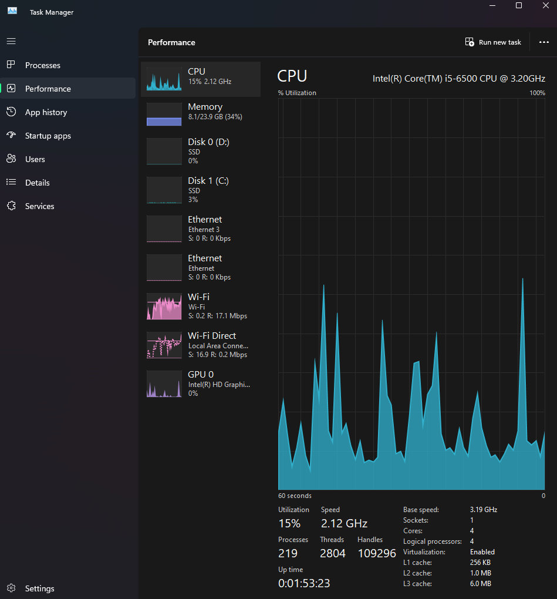
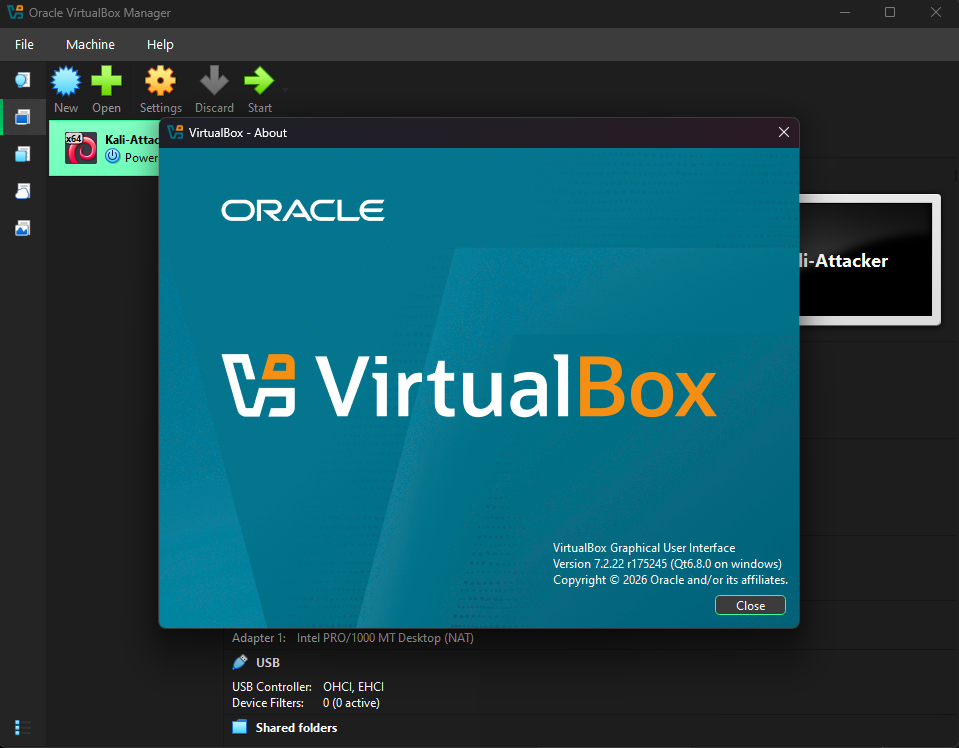
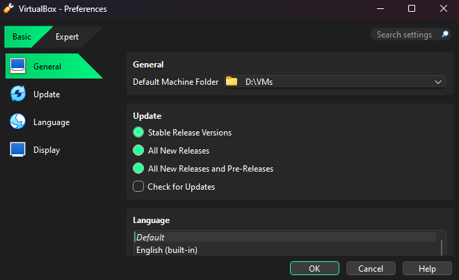
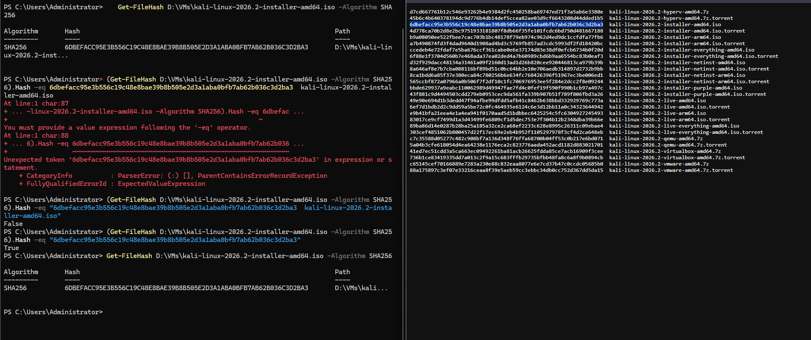
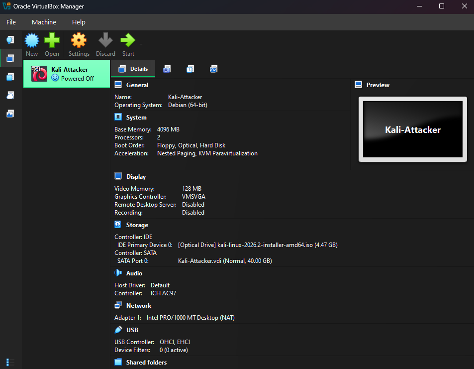

 01 - Environment Setup

Goal: Prepare a host machine and virtualization platform for a home security lab.

 1. Host readiness
Checked that hardware virtualization is enabled and that no conflicting
Windows hypervisor features (Hyper-V, Virtual Machine Platform) are active.

- Host: Windows 11, 4-core CPU, 24 GB RAM, separate SSD for VM storage

 2. VirtualBox installation
Installed Oracle VirtualBox 7.2.22 from the official site and moved the
default machine folder to a dedicated drive to keep the system drive free.

 3. ISO integrity verification
Verified the Kali Linux 2026.2 installer ISO against the SHA-256 hash
published on Kali's official download server before using it.

Result: `True`. An earlier attempt returned `False` because the filename
was pasted along with the hash. Only the 64-character hash should be compared.

 4. First VM: Kali-Attacker

 Setting  Value 

| OS type | Debian (64-bit) |
| RAM | 4096 MB |
| CPUs | 2 |
| Disk | 40 GB (dynamic) |
| Video memory | 128 MB |

 Lessons learned
- VirtualBox misdetected Kali as Ubuntu. Kali is Debian-based, so I corrected the OS type.
- Always verify ISOs against official hashes before installing.

