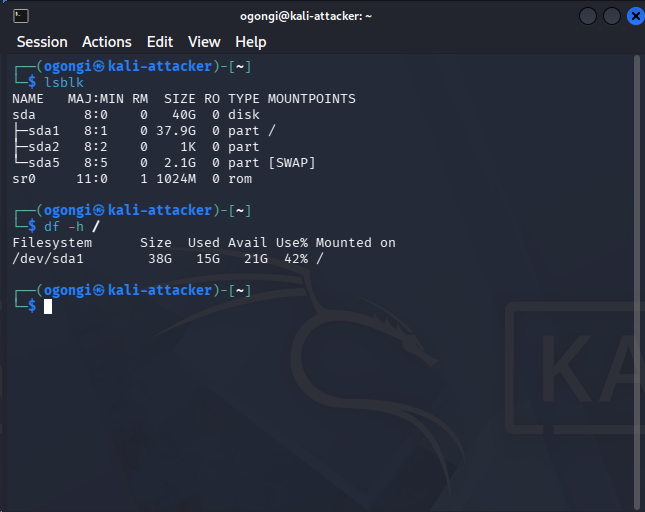
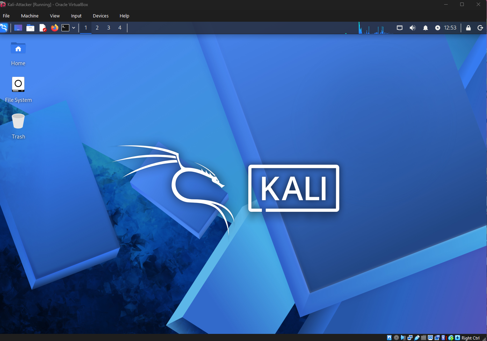
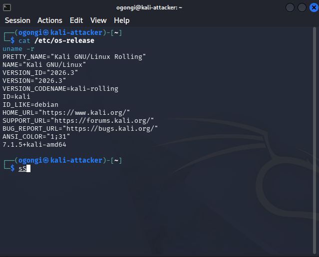
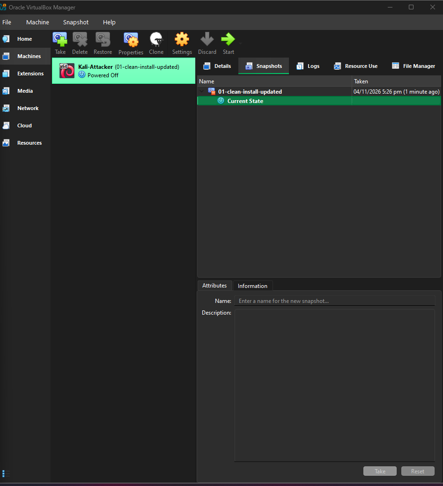

02 - Kali Linux Attacker VM

Goal: Install and prepare Kali Linux as the attacker machine for the lab.

 1. Installation
Installed Kali Linux 2026.2 from the verified installer ISO using the
graphical installer, with manual (non-unattended) setup.

- Hostname: `kali-attacker`
- Non-default username and a strong password (not stored in this repo)
- Guided partitioning: entire 40 GB virtual disk, single partition
- Default Xfce desktop and default tool selection




## 2. Updating the system
```bash
sudo apt update
sudo apt full-upgrade -y
sudo reboot
```



## 3. Snapshot
Took a snapshot of the clean, updated system so I can roll back after
experiments.

| Snapshot | Purpose |
|---|---|
| `01-clean-install-updated` | Fresh Kali 2026.2, fully updated, before any lab changes |



## Troubleshooting notes
- **"No bootable medium found":** the installer ISO was not attached. Fixed by
  attaching the ISO under Settings → Storage.
- **"Image file inaccessible" warning:** the ISO had been removed from the VM
  folder (only a shortcut remained). Fixed by re-copying the ISO from backup
  and re-verifying its SHA-256 hash.

## Lessons learned
- Keep installer ISOs outside VM folders and don't clean them up mid-project.
- Take a snapshot before every major change.
