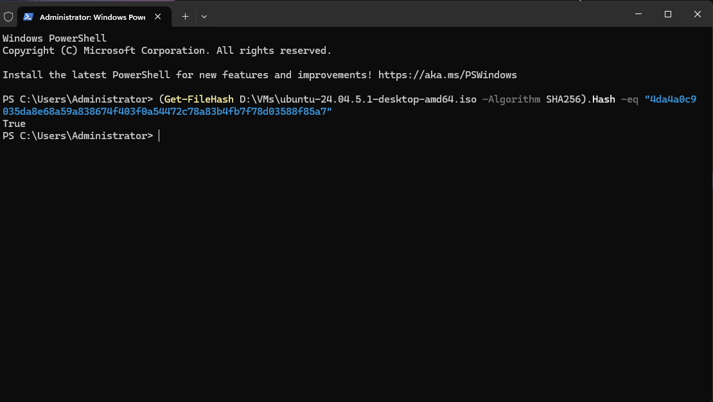
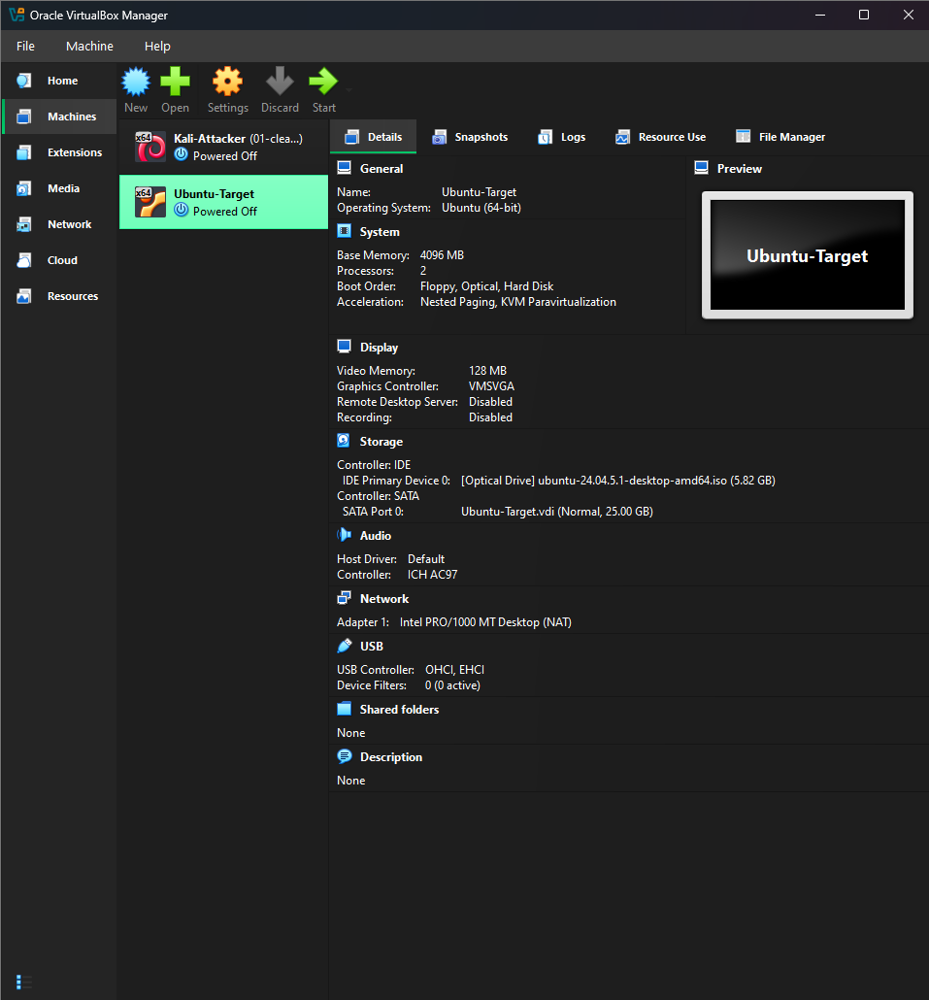
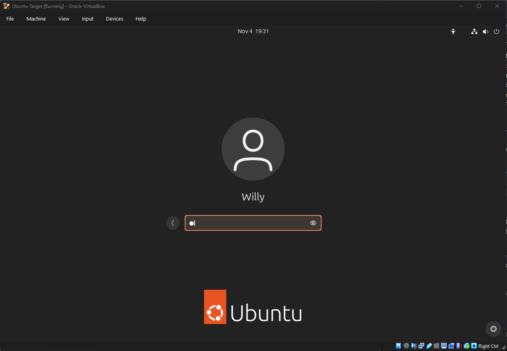
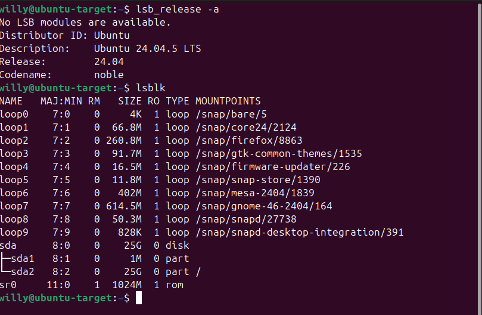
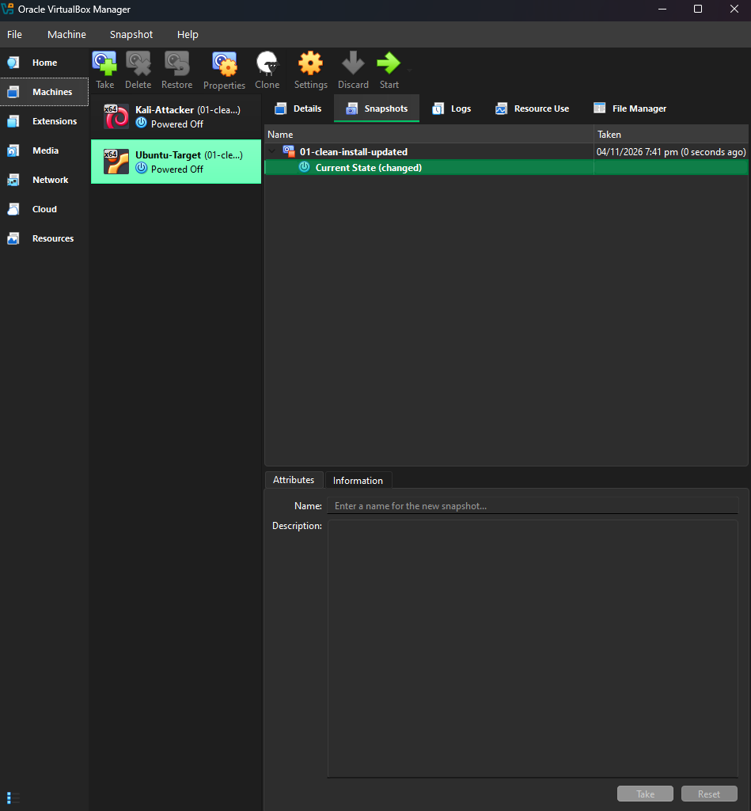

03 - Ubuntu Target VM

Goal: Build a second machine to act as the target for scanning and defensive exercises.

1. ISO verification
Verified the Ubuntu 24.04.5 desktop ISO against the SHA-256 hash published
on Ubuntu's official release server before using it. Result: `True`.



2. VM configuration

| Setting | Value |
|---|---|
| OS type | Ubuntu (64-bit) |
| RAM | 4096 MB |
| CPUs | 2 |
| Disk | 25 GB (dynamic) |
| Video memory | 128 MB |



## 3. Installation
Installed Ubuntu 24.04.5 LTS with the default selection and the erase-disk
option (applies to the virtual disk only). Proprietary software options
were left off. Hostname: `ubuntu-target`.




4. Updating and snapshot
```bash
sudo apt update && sudo apt full-upgrade -y
sudo reboot
```

Took a snapshot of the clean, updated system.

| Snapshot | Purpose |
|---|---|
| `01-clean-install-updated` | Fresh Ubuntu 24.04.5, fully updated, before any lab changes |



Lessons learned
- Copy installers with `Copy-Item` rather than drag and drop, and confirm the file size to avoid ending up with a shortcut instead of the real file.
- Attach the ISO before first boot.
