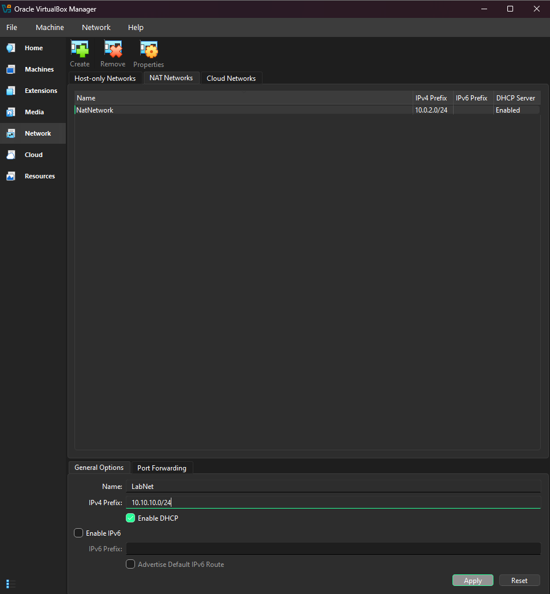
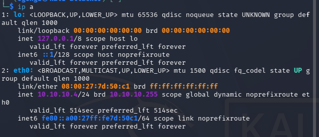
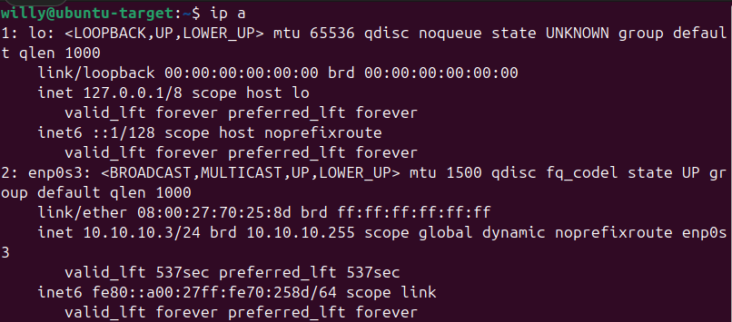
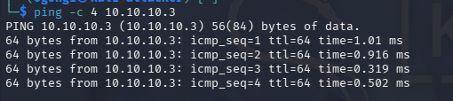
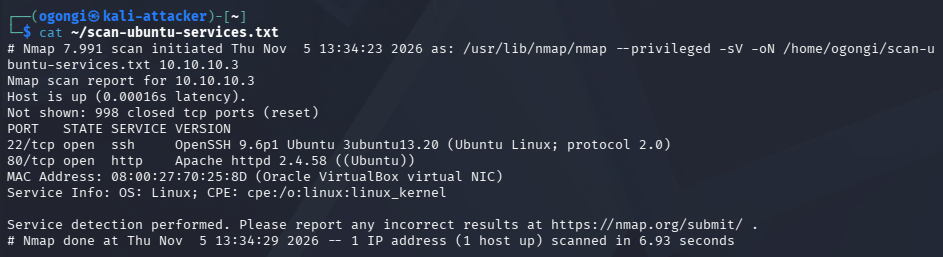
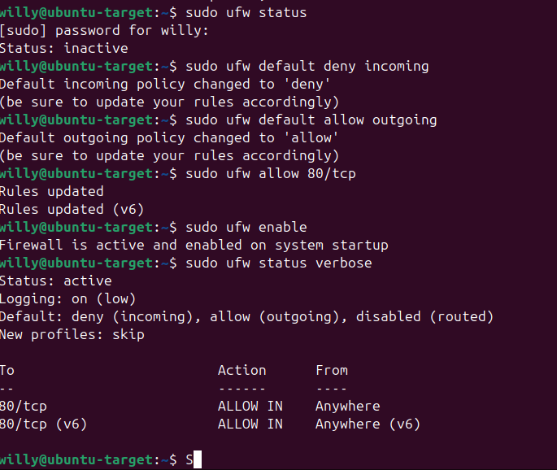
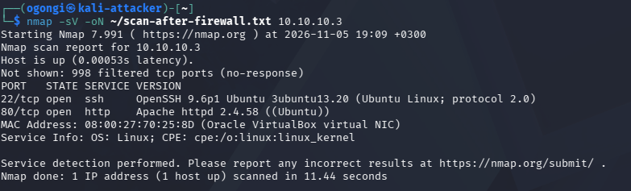
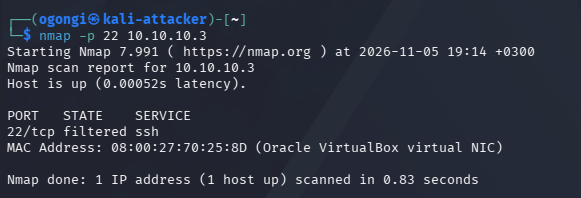
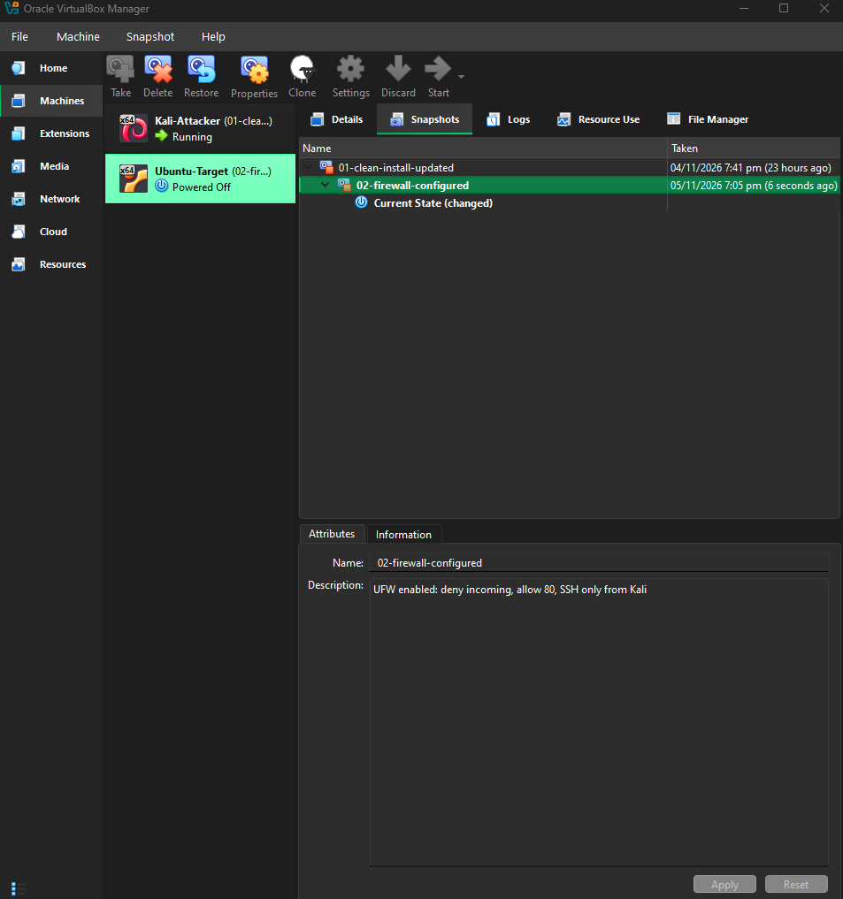

04 - Lab Network, Scanning and Firewall

Goal: Connect the attacker and target on an isolated network, scan the target like an attacker would, then harden it with a firewall and measure the difference.

> All scanning was done only against machines I own, inside an isolated lab network.

1. Isolated lab network
Created a VirtualBox **NAT Network** (`LabNet`, `10.10.10.0/24`, DHCP on) and attached both VMs to it. The VMs can reach each other and the internet, but nothing on my regular network can reach them.

| Machine | Role | IP |
|---|---|---|
| Kali-Attacker | Attacker | 10.10.10.4 |
| Ubuntu-Target | Target | 10.10.10.3 |






Ping succeeded in both directions with 0% packet loss.

## 2. Giving the target services
Installed an SSH server and a web server on Ubuntu:

```bash
sudo apt install -y openssh-server apache2
```

On Ubuntu 24.04 SSH uses socket activation: `ssh.service` can show as inactive while `ssh.socket` is listening on port 22.

## 3. Scan before hardening
```bash
nmap -sV 10.10.10.3
```

| Port | State | Service | Version |
|---|---|---|---|
| 22/tcp | open | ssh | OpenSSH 9.6p1 (Ubuntu 3ubuntu13.20) |
| 80/tcp | open | http | Apache httpd 2.4.58 (Ubuntu) |

The other 998 ports were reported as `closed (reset)`, meaning the target answered every probe and no firewall was filtering traffic.



 4. Hardening with UFW
UFW (Uncomplicated Firewall) is a simple front end for the Linux kernel firewall.

```bash
sudo ufw default deny incoming
sudo ufw default allow outgoing
sudo ufw allow 80/tcp
sudo ufw allow from 10.10.10.4 to any port 22 proto tcp
sudo ufw enable
```

Policy: deny all incoming by default, allow web traffic, and allow SSH only from the attacker/admin machine.



## 5. Scan after hardening
```bash
nmap -sV -oN ~/scan-after-firewall.txt 10.10.10.3
```

| | Before firewall | After firewall |
|---|---|---|
| Open ports | 22, 80 | 22 (from Kali only), 80 |
| Other 998 ports | closed (reset) | filtered (no response) |
| Scan time | ~7 s | ~11.4 s |

Unused ports changed from `closed` to `filtered`: the target now drops packets silently, so a scanner learns nothing about them. The scan also takes longer because nmap waits on replies that never arrive.



### SSH restriction test
With the SSH allow rule temporarily removed, port 22 showed as `filtered`. After restoring the rule, it was open again, but only from `10.10.10.4`.



## 6. Defender analysis
1. **What was open?** Port 22 (OpenSSH 9.6p1) and port 80 (Apache 2.4.58). Version banners are exposed, so an attacker could look up known vulnerabilities for those exact versions.
2. **What is actually needed?** The web service is the machine's purpose, so port 80 is needed. SSH is only needed for administration, so it should not be reachable by everyone.
3. **How to reduce the attack surface?** Deny incoming traffic by default, open only required ports, restrict SSH to trusted source addresses, keep packages patched, and disable services that are not needed.

## 7. Snapshot
| Machine | Snapshot | Purpose |
|---|---|---|
| Ubuntu-Target | `02-firewall-configured` | UFW enabled: deny incoming, allow 80, SSH only from Kali |



## Lessons learned
- Command-line flags are case-sensitive: `-sv` failed, `-sV` is the version scan.
- `closed` and `filtered` mean different things: closed ports answer, filtered ports stay silent.
- Deny by default and allow only what is needed.
