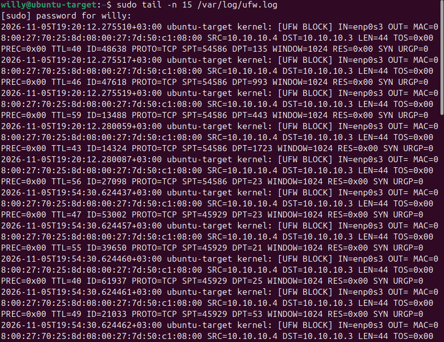
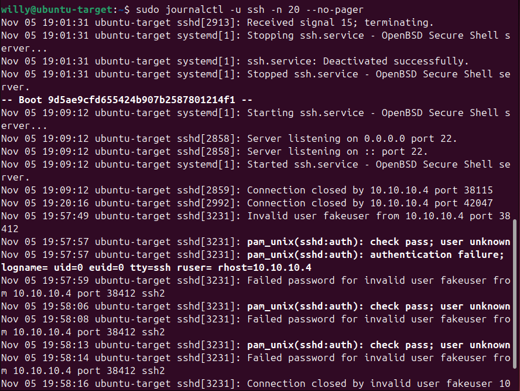
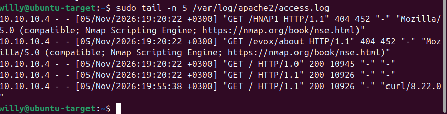

# 05 - Log Analysis: Seeing My Own Attack

**Goal:** Review what the firewall, SSH server, and web server recorded about my own scans and failed logins, from a defender's point of view.

> All activity was between my own VMs on an isolated lab network.

## Activity generated from Kali
```bash
nmap -p 1-100 10.10.10.3
curl http://10.10.10.3
ssh fakeuser@10.10.10.3   # wrong passwords entered on purpose
```

## 1. Firewall log (`/var/log/ufw.log`)
UFW records blocked traffic as `[UFW BLOCK]` lines.

```bash
sudo tail -n 15 /var/log/ufw.log
```



| Indicator | What it showed |
|---|---|
| Source | A single address (10.10.10.4) |
| Ports probed | Many different ports (135, 993, 443, 1723, 23, 21, 25, 53) |
| Timing | Several ports within milliseconds |
| Port order | Randomized, not sequential |
| Source port | Constant within each scan burst |
| Packet type | SYN only, small packets, no completed connections |

Conclusion: one source probing many ports very quickly with half-open connections is the signature of a port scan.

Note: UFW only logs blocked traffic. Probes to allowed ports (22, 80) appear in the service logs instead.

## 2. SSH log
```bash
sudo journalctl -u ssh -n 20 --no-pager
```



Suspicious indicators:
- `Invalid user fakeuser`: an account that does not exist
- Repeated `Failed password` entries from one address within seconds
- `pam_unix ... user unknown` and `PAM 2 more authentication failures`
- `Connection closed ... [preauth]`: the client gave up before authenticating
- Short `Connection closed by 10.10.10.4` entries with no login matched my nmap scan times: the scanner connected, read the banner and left

## 3. Web server log (`/var/log/apache2/access.log`)
```bash
sudo tail -n 5 /var/log/apache2/access.log
```



| Request | User agent | Meaning |
|---|---|---|
| `GET /HNAP1`, `GET /evox/about` (404) | Nmap Scripting Engine | Scanner fingerprinting probes for pages that do not exist |
| `GET / HTTP/1.0` (200) | none | Real browsers always send one, so a blank value suggests a script |
| `GET / HTTP/1.1` (200) | `curl/8.22.0` | Command-line client, not a person browsing |

User agents are self-reported and easy to fake, so they are a clue to combine with request patterns and timing, not proof.

## What I would do in a real environment
- Allow SSH with keys only and disable password login
- Rate-limit or ban repeat offenders (for example with fail2ban)
- Send logs to a central place so all three can be correlated
- Alert on many blocked connections from a single source in a short time

## Lessons learned
- No single log tells the whole story: the firewall, SSH and web logs each show a different part of the same scan.
- Attackers' tools leave identifiable patterns even when they only probe.
